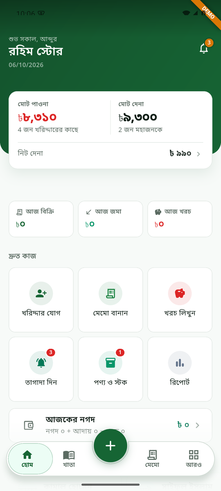
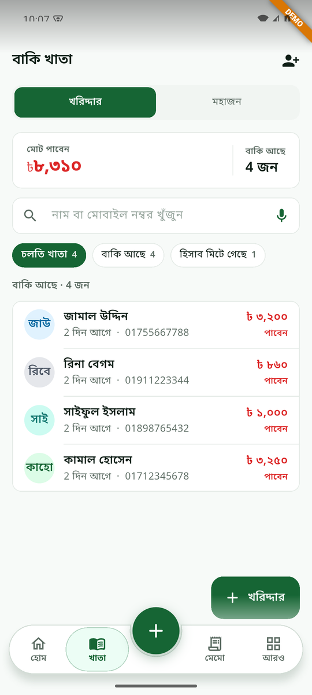
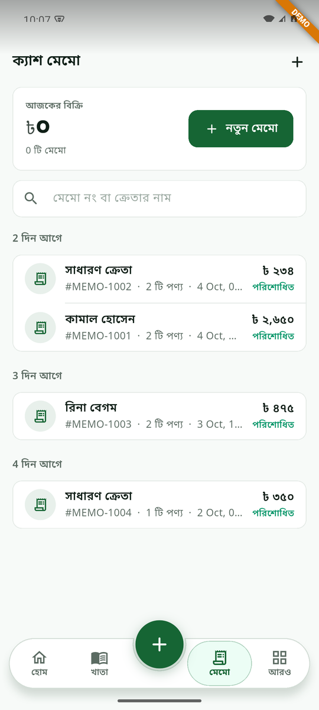
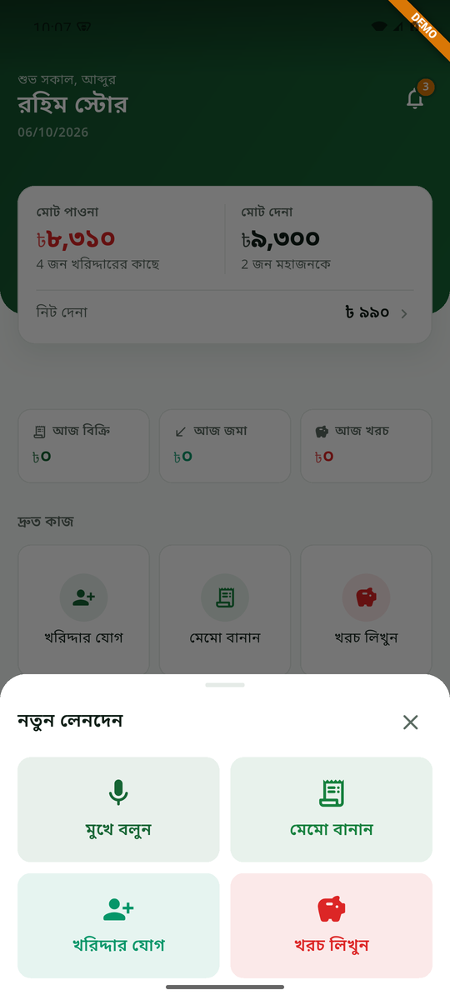
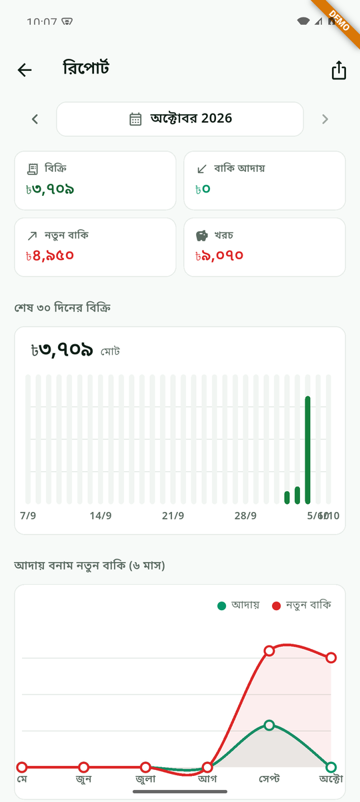
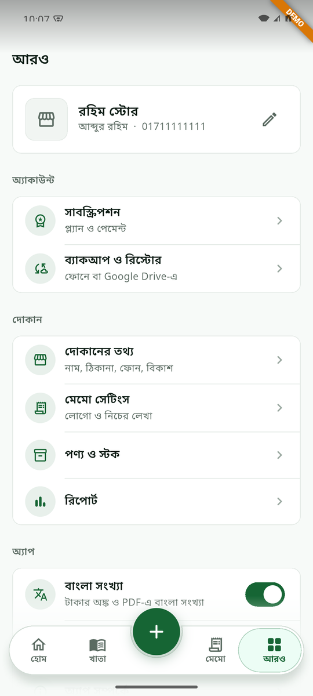

# দোকানদার (Dukandar)

An offline-first ledger (বাকি খাতা), cash memo and billing app for small shops in Bangladesh, sold as a monthly subscription.

## Screenshots

| Home | Ledger (বাকি খাতা) | Cash Memo |
|:---:|:---:|:---:|
|  |  |  |
| **New Transaction** | **Reports** | **More / Settings** |
|  |  |  |

## Features

- **Customer & supplier ledger**: track who owes you and who you owe
- **Cash memo**: create memos and share or print them as PDF
- **Daily cash drawer**: sales, collections and expenses
- **Products & stock**: with low-stock alerts
- **Reports**: monthly sales, dues and expense charts
- **Voice input**: add entries by speaking in Bangla
- **Backup**: local backup plus Google Drive
- **Reminders**: due-payment notifications
- Fully in Bangla, including Bangla numerals

## Project structure

```
app/           Flutter mobile app (business data stays on the phone)
backend/       FastAPI: shop accounts, subscriptions, device lock, notifications
admin-panel/   Admin web UI (served by the backend at /admin)
docs/          API contract and screenshots
```

## Getting started

**Backend**
```bash
cd backend
python3 -m venv .venv && .venv/bin/pip install -r requirements.txt
cp .env.example .env        # set SUPERADMIN_EMAIL, SUPERADMIN_PASSWORD, DATABASE_URL
.venv/bin/uvicorn app.main:app --reload
```
Admin panel: http://127.0.0.1:8000/admin

**App**
```bash
cd app
flutter run                                   # Android emulator reaches the host at 10.0.2.2
flutter run --dart-define=DUKANDAR_DEMO=true  # demo mode with sample data, no server needed
flutter run --dart-define=DUKANDAR_API=https://your-host/api/v1
```

**Production (Docker)**
```bash
docker compose up -d --build
```

See [backend/README.md](backend/README.md), [admin-panel/README.md](admin-panel/README.md) and [docs/API_CONTRACT.md](docs/API_CONTRACT.md) for details.
